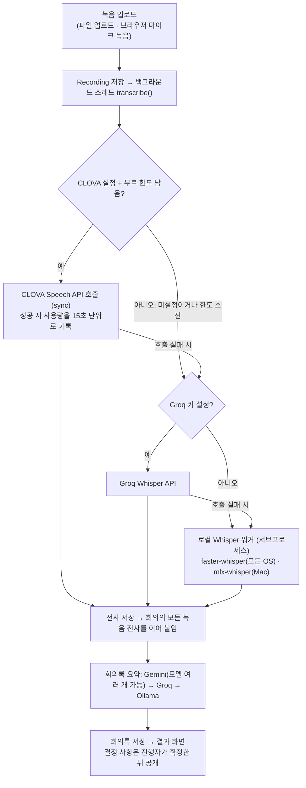

# MeetAlign 소프트웨어 사양서 (간략판)

2026-11-09 기준(최초 작성 2026-10-24) · 작성: cocoa030722 · 처음 작성한 아티팩트(10-24 판, 이 문서보다 오래됨): https://claude.ai/artifact/2cvBg31S8WuaRMDceXPAd3

## 개요

MeetAlign(합의착시탐지기)은 회의 녹음 하나로 회의록을 만들고, 사람마다 다르게 이해할 수 있는 결정을 하나의 확정 문장으로 정리해 팀원에게 알려 주는 웹 서비스다. 대상은 주최자 1명과 팀원 여럿으로 이루어진 소규모 프로젝트 팀이다.

해결하려는 문제는 '합의 착시'다. 회의가 끝나면 모두 같은 결론에 동의했다고 믿지만, 기한·범위·담당자를 사람마다 다르게 기억하는 일이 잦다. MeetAlign은 녹취 원문에서 결정을 뽑아 그대로 공개될 확정 문장으로 옮기고, 다르게 이해될 수 있는 결정에는 AI 추천 문장을 붙여 진행자가 고르게 한다. 진행자가 공개하면 참석자에게 알림이 가고, 팀원은 근거가 된 녹취 원문을 하이라이트로 보며 결정을 읽는다.

현재 버전은 Django 단일 앱이다. 전사는 네이버 CLOVA Speech, Groq Whisper, 로컬 Whisper가(필요하면 로컬 화자 분리 포함), 회의록 요약과 결정 사항 추출은 Gemini API, Groq, 로컬 Ollama가 맡는다.

## 주요 기능

핵심 흐름은 녹음 → 전사 → 회의록 → 결정 사항 → 결정 공개·알림의 다섯 단계다.

1. 녹음 업로드: 파일 업로드 또는 브라우저 마이크 녹음(MediaRecorder, 일시정지·이어서 녹음 가능). 16개 형식(mp3, m4a, wav, webm 등), 500MB 이하, 회의당 여러 개.
2. 전사(STT): 업로드 즉시 백그라운드 스레드에서 처리하고 결과 화면이 5초마다 새로고침된다. 녹음이 여러 개면 파일명 구획으로 이어 붙이고, 설정하면 말한 사람을 "화자 A: …"로 나눈다.
3. 회의록 요약: [요약] [결정된 사항] [아직 논의 중인 사항] [할 일] [숫자와 기한] [모호한 표현] 6개 섹션. record.txt로 내려받을 수 있다.
4. 결정 사항 추출: 녹취 원문에서 결정을 안건 한 줄과 확정 문장으로 옮긴다(회의당 최대 12개). 다르게 이해될 수 있다고 AI가 본 결정, 또는 모호어·날짜 충돌·지시어가 남은 결정에는 사유를 달고 AI 추천 문장 1개를 진행자에게만 보여준다. 진행자는 항목마다 추천 문장을 고르거나, 직접 쓰거나, 다음 회의로 넘기거나, 뺄 수 있다. 고르지 않은 확인 필요 항목은 공개할 때 빠지고, 다음 회의로 넘긴 항목은 다음 회의에 이월된다.
5. 결정 공개·알림: 진행자가 공개하면 참석자(회의 생성 때 고르고 나중에 바꿀 수 있음)에게 알림이 가고, 공개 뒤 문장을 고쳐도 "수정됨" 알림이 간다. 상단 알림 아이콘, 회의 목록의 "새 결정"/"수정됨" 배지, 회의 화면 안내로 보이며 결정 화면을 열면 지워진다. 팀원은 한 문항씩 읽기 전용으로 보며 확인 응답은 받지 않는다.

부가 기능: 6자리 팀 초대 코드, 회의 마감일과 D-1 배너, 익명 질문(질문한 본인만 답변 열람), 회의록 기반 대화창(최근 3턴 기억, 모르는 용어는 `[일반 지식]`으로 설명), 회의 종료, 팀·회의 삭제.

## 시스템 구성

Django 앱 하나(`meetalign`)가 화면·모델·백그라운드 처리·외부 연동을 모두 맡고, 데이터는 SQLite와 media/ 폴더에 둔다. 전사와 요약은 환경변수에 따라 외부 API와 로컬 모델 사이를 자동으로 오간다.

CLOVA가 설정돼 있고 이번 달 무료 사용량이 남아 있을 때만 CLOVA를 부르고, 아니면 Groq Whisper(키가 있을 때) → 로컬 Whisper 순으로 넘어간다. 어느 엔진도 없으면 전사는 비어 있고 요약·결정 사항 추출도 고정 응답으로 대체된다(가짜 응답 모드).

## 외부 연동과 실행 환경

서버는 Python 3.12 이상(검증은 3.14) + Django 6.1 + SQLite로 Windows·macOS·Linux에서 같게 동작하며, 전사·요약 엔진은 환경변수로만 바뀐다. 아무것도 설정하지 않으면 가짜 응답 모드로 화면 흐름만 확인할 수 있다.

| 역할 | 1순위 | 다음 순위로 넘어가는 조건 | 다음 순위 |
|---|---|---|---|
| 전사(STT) | 네이버 CLOVA Speech (`CLOVA_SPEECH_INVOKE_URL`, `CLOVA_SPEECH_SECRET_KEY`) | 이번 달 무료 사용량(`CLOVA_SPEECH_FREE_MINUTES`, 기본 20분) 소진, 또는 호출 실패(키 오류·네트워크·서버 오류) | ① Groq Whisper (`GROQ_API_KEY`) → ② 로컬 Whisper: `FASTER_WHISPER_MODEL`(모든 OS, NVIDIA GPU 자동 사용) 또는 `MLX_WHISPER_MODEL`(Apple Silicon). `LOCAL_DIARIZATION=1`이면 Groq·로컬 결과에 로컬 화자 분리(sherpa-onnx) 적용 |
| 요약·결정 사항·대화 | Google Gemini API (`GEMINI_API_KEY`, `GEMINI_MODEL`) | 429/500/503을 1회 재시도 후에도 실패, 타임아웃(기본 60초), 하루 한도 초과, 키 오류, 빈 응답. `GEMINI_MODEL`에 쉼표로 적은 모델이 여럿이면 다음 모델부터 시도하고, 실패한 모델은 10분간 건너뜀 | ① Groq (`GROQ_LLM_MODEL`, 키는 STT와 공용) → ② 로컬 Ollama (`OLLAMA_MODEL`, 컨텍스트 16384) |

무료 사용량 정책: CLOVA를 호출할 때마다 음성 길이를 15초 단위로 올림해 `SttUsage` 테이블에 기록하고, 매월 1일 0시에 집계를 새로 시작한다. 지금까지 사용량에 이번 녹음 길이를 더해 한도를 넘길 것으로 보이면 호출하지 않고 바로 로컬로 보낸다. 회의 상세 화면에 "이번 달 무료 사용량 n/20분"이 표시된다.

## 데이터와 프라이버시

모든 데이터는 로컬 SQLite(db.sqlite3)와 media/ 폴더에 남는다: 사용자 계정, 팀과 초대 코드, 회의(제목·마감일·주최자·녹취 원문·회의록), 녹음 파일, 전사 상태와 오류 메시지, 결정 사항과 AI 추천 문장, 결정 알림, 회의 참석자, 익명 질문(작성자는 내부 저장, 화면에는 비노출), 사용자별 대화 기록, CLOVA 사용량.

외부로 나가는 데이터: CLOVA를 설정하면 녹음 파일이 네이버 클라우드로, Groq를 설정하면 녹음 파일(STT)과 전사본·회의록·질문(LLM)이 Groq로, Gemini를 설정하면 전사본·회의록·질문이 Google로 전송된다. 로컬 Whisper(화자 분리 포함)와 Ollama만 쓰면 아무것도 외부로 나가지 않는다. 무료 Gemini 키는 입력이 서비스 개선에 쓰일 수 있어, 민감한 회의는 로컬 구성을 권장한다.

권한 모델:

- 모든 화면은 로그인 필수. 팀 멤버만 그 팀의 회의에 접근한다.
- 녹음 파일은 /media/ 공개 경로 없이 회의 멤버에게만 뷰를 통해 전달한다.
- 진행자 전용: 결정 사항 검토·확정·공개·공개 취소·공개 뒤 문장 수정, 참석자 지정, 익명 질문 전체 열람과 답변, 회의 삭제. 팀 삭제는 팀 생성자만.
- 알림은 참석자(진행자 제외)에게만 가고, 팀원의 결정 확인 응답은 받지 않아 누가 무엇을 확인했는지는 기록하지 않는다.

## 검증 현황

자동 테스트 437개가 전부 통과한다(`python manage.py test`, 약 3초, 2026-11-09 실행). 테스트는 실제 모델이나 API를 부르지 않으며, 셸에 실행용 키가 있어도 시작 시 치워 두어 결과가 같다.

실측(2026-10-24, Windows 11 노트북, RTX 4060 Laptop, Python 3.14. 이후 추가된 Groq·화자 분리·마이크 일시정지 등은 자동 테스트로만 확인했고 다시 실측하지 않았다):

- CLOVA Speech(Free 도메인, 실제 키): 24초 한국어 음성을 2.5초에 전사, 사용량 30초 기록. 합성음 테스트에서 사람 이름 하나가 통째로 빠지는 현상을 관찰했다(같은 음성을 Whisper는 정확히 전사).
- faster-whisper large-v3-turbo(GPU, float16): 같은 음성을 모델 로딩 포함 7초에 전사. base 모델은 CPU int8로 4초.
- Gemini 무료 등급: 짧은 요청도 1~4분 걸리는 경우가 있었다. 이후 타임아웃을 60초로 줄이고 다중 모델·Groq·Ollama 전환으로 대응했다(이 전환 로직은 실측하지 않음).
- 이전 단계(mlx-whisper + Ollama)에서 실제 50분 수업 녹음과 28분 회의 녹음으로 전사→요약→문제→대화→불일치 전체 파이프라인을 검증한 이력이 있다.

## 제약 사항과 향후 과제

현재 한계:

- 백그라운드 전사가 개발 서버의 스레드에 묶여 있어(작업 큐 없음) 서버가 재시작되면 진행 중이던 녹음은 "실패"로 복구되고 다시 시도 버튼으로 재처리해야 한다. 단일 프로세스와 SQLite를 전제한다.
- 팀원의 결정 확인 응답과 집계는 알림 방식으로 대체되어 사라졌다. 앱은 "모두 같게 이해했는지"를 확인하지 않고 공개·수정 사실만 알린다.
- CLOVA 사용량 장부는 이 앱이 보낸 호출만 세며, 길이를 미리 알 수 없는 파일은 마지막 한 건이 한도를 넘길 수 있다. Free 플랜의 정확한 무료량과 초과 시 동작은 공식 문서에 수치가 없다.
- faster-whisper 1.2.1은 PyAV 19와 호환되지 않아 `av<19` 고정이 필요하다.
- 마이크 녹음은 브라우저 정책상 localhost 또는 https에서만 동작한다.

향후 과제: 실제 회의 녹음으로 CLOVA 고유명사(이름) 인식 확인, 추적되지 않는 빈 디렉터리(meetalign/services/, static/vendor/) 정리, 배포 설정(DJANGO_DEBUG=0, DJANGO_SECRET_KEY) 점검.
