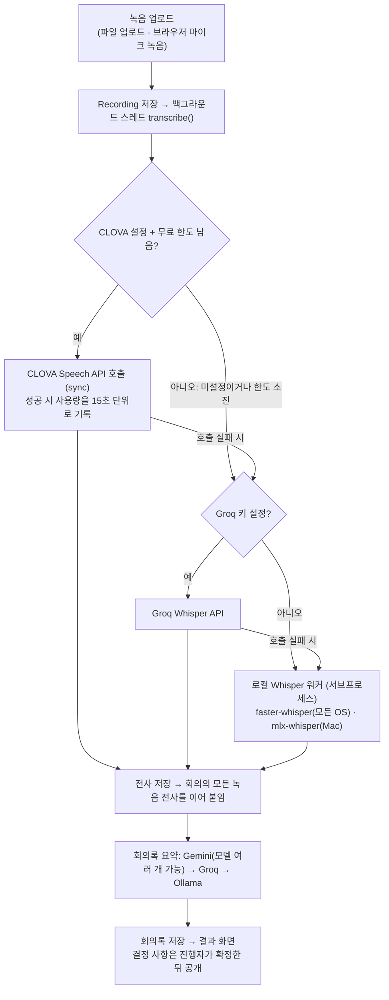

# MeetAlign 소프트웨어 사양서 (상세판)

2026-11-09 기준(최초 작성 2026-10-24) · 작성: cocoa030722 · 처음 작성한 아티팩트(10-24 판, 이 문서보다 오래됨): https://claude.ai/artifact/7HuGnht61gxmRqnPp5sVhr

## 1. 문서 개요

이 사양서는 2026-11-09 기준으로 `main`에 머지된 내용(PR #52 마이크 녹음 일시정지까지)에서 실제로 구현된 MeetAlign의 동작을 기술한다. 설계 문서의 계획이 아니라 코드와 테스트가 보증하는 범위만 다루며, 구현되지 않은 항목은 12장에 따로 적는다.

| 용어 | 뜻 |
|---|---|
| 전사(transcript) | 녹음을 글로 옮긴 원문. 녹음마다 `Recording.transcript`, 회의 전체는 `Meeting.transcript` |
| 회의록(record) | 전사를 LLM이 정리한 요약문. `Meeting.record` |
| 결정 사항(Decision) | 회의 원문에서 뽑은 결정 하나. 안건 한 줄(`what`)과 팀원에게 그대로 공개될 확정 문장(`final_text`)을 갖는다. 초안(draft)으로 생성되어 진행자가 공개(published)하고, '다음 회의로 넘김'을 고른 항목만 undecided가 된다 |
| AI 추천 문장(Interpretation) | 다르게 이해될 수 있다고 본 결정에 LLM이 만든 확정 문장 후보. 결정당 1개이며 진행자에게만 보여준다. 지금 코드에서는 모델명이 Interpretation이고 UI에서는 '후보'로 부른다 |
| 진행자(host) | 회의를 만든 사용자. 결정 사항 검토·확정·공개, 익명 질문 답변, 회의 삭제, 참석자 지정 권한을 가진다 |
| 참석자 | 회의를 만들 때 고르고(진행자는 항상 포함) 진행자가 회의 화면에서 바꿀 수 있는 팀원. 결정 공개·수정 알림을 받는 범위다. 고르지 않은 회의(옛 회의)는 팀 멤버 전원으로 본다 |
| 알림(Notification) | 진행자가 결정을 공개하거나 공개 뒤에 고치면 진행자를 뺀 참석자마다 남기는 기록. 회의당 안 읽은 알림은 한 사람에게 하나다 |
| 가짜 응답 모드 | STT/LLM 환경변수가 하나도 없을 때 고정 결정 사항·녹취 원문 그대로 등으로 화면 흐름만 동작하는 상태 |

## 2. 시스템 개요

회의 뒤 참석자들이 같은 결정을 다르게 기억하는 '합의 착시'는 회의록만으로는 잡기 어렵다. MeetAlign의 목표는 녹음 하나로 회의록을 만들고, 다르게 이해될 수 있는 결정을 진행자가 하나의 확정 문장으로 정리해 근거와 함께 팀원 전원에게 공개하고 알리는 것이다.

| 역할 | 할 수 있는 일 |
|---|---|
| 비로그인 | 랜딩 화면, 회원가입, 로그인 |
| 팀원 | 팀 생성 또는 초대 코드로 참여, 회의 생성(만든 사람이 진행자, 참석자 선택), 녹음 업로드와 마이크 녹음(일시정지·이어서 녹음), 결과·회의록·녹취 원문 열람, 회의록 다운로드, 공개된 결정 사항 열람(읽기 전용)과 결정 알림 확인, 익명 질문 보내기(본인 것만 열람), 대화창 |
| 진행자 | 팀원 권한에 더해 결정 사항 검토·확정·공개·공개 취소·공개 뒤 문장 수정, 회의 참석자 지정, 익명 질문 전체 열람과 답변, 이월된 미정 항목 처리, 회의 삭제 |
| 팀 생성자 | 팀 삭제 |

전체 사용 시나리오:

1. 팀원이 팀을 만들거나 6자리 초대 코드로 참여한다.
2. 진행자가 회의를 만들고(제목, 선택적 마감일) 녹음을 올린다. 업로드 즉시 백그라운드 전사가 시작되고 결과 화면이 5초마다 새로고침된다.
3. 전사가 끝나면 회의록이 생성된다. 진행자가 "결정 확인" 화면에서 결정 사항을 추출하고, 다르게 이해될 수 있는 항목마다 AI 추천 문장을 고르거나 직접 쓰거나 '다음 회의로 넘김'·'이 결정 빼기'를 고른 뒤 공개한다.
4. 공개하면 참석자에게 알림이 간다. 상단 알림 아이콘, 팀 홈 회의 목록의 "새 결정" 배지, 회의 화면 위 안내로 보이며, 팀원이 결정 확인 화면을 열면 그 회의 알림은 읽은 것으로 보고 지운다. 팀원은 한 문항씩 넘겨 읽으며 근거가 된 녹취 원문을 하이라이트로 볼 수 있다. 확인 버튼은 없다.
5. 공개 뒤에 진행자가 문장을 고치면 "수정됨" 알림이 간다. 미정 항목은 다음 회의 상세에 이월된다. 대화창에서 회의록 기반 질문을 하거나 익명 질문을 보낼 수 있다.

## 3. 시스템 아키텍처

단일 Django 프로젝트(`APL_04/setting`) 안의 앱 하나(`meetalign`)가 화면, 모델, 백그라운드 처리, 외부 연동을 모두 담당하며, 별도의 작업 큐나 외부 서비스 없이 개발 서버 한 프로세스로 동작한다.



CLOVA가 설정돼 있고 이번 달 무료 사용량이 남아 있을 때만 CLOVA를 부르고, 아니면 Groq Whisper(키가 있을 때) → 로컬 Whisper 순으로 넘어간다. Groq·로컬 Whisper 결과에는 `LOCAL_DIARIZATION=1`일 때 로컬 화자 분리(sherpa-onnx)를 붙여 "화자 A: …" 줄로 나눈다(CLOVA는 자체 화자 구분을 쓴다). 어느 엔진도 없으면 전사는 비어 있고 요약·결정 사항 추출도 고정 응답으로 대체된다(가짜 응답 모드).

| 구성 요소 | 위치 | 역할 |
|---|---|---|
| 웹 앱 | `meetalign/views.py`, `urls.py`, `templates/meetalign/*.html` | URL 20개, 서버 렌더링 템플릿. 공통 `base.html`에 폼 제출 로딩 스피너, 내일 마감 배너, 상단 알림 아이콘 |
| 데이터 | `db.sqlite3`, `media/recordings/` | 모델 11개(5장), 녹음 파일 원본 |
| 백그라운드 처리 | `meetalign/tasks.py` | 업로드마다 데몬 스레드 1개. 회의별 락으로 같은 회의의 전사 합치기를 직렬화. 재시작으로 끊긴 녹음을 실패로 복구(`recover_stuck`) |
| STT/LLM 연결 | `meetalign/services.py` | 엔진 선택, CLOVA·Groq 호출과 CLOVA 사용량 장부, Gemini/Groq/Ollama 호출, 프롬프트, 언어 필터 |
| 결정 사항 컴파일러 | `meetalign/decision_compiler.py` | 결정 추출 프롬프트, 응답 파싱·근거 검증, 규칙 안전망(경고), 공개·문장 수정, 근거 위치 찾기, 이월 조회 |
| 로컬 Whisper 워커 | `meetalign/whisper_worker.py` | Django 의존 없는 스크립트. 서브프로세스로 실행해 mlx의 GPU 스레드 충돌을 피하고 수 GB 모델을 서버 프로세스 밖에 둔다 |
| 로컬 화자 분리 워커 | `meetalign/diarize_worker.py` | Django 의존 없는 스크립트. sherpa-onnx(pyannote 분할 + NeMo TitaNet 임베딩)로 CPU에서 화자 구간을 낸다. 모델(약 47MB)은 첫 실행에 내려받는다 |
| 알림 | `meetalign/notifications.py` | 결정 공개·수정 알림 생성(회의당 안 읽은 것은 한 사람에게 하나), 공개 취소 시 거둠, 읽음 처리(삭제), 회의 목록 배지 조회(회의 수와 무관하게 쿼리 1회) |
| 전역 컨텍스트 | `meetalign/context_processors.py` | 내일 마감인 회의(`due_soon`)와 읽지 않은 알림 수(`notification_count`)를 모든 화면에 |
| 설정 | `setting/settings.py` | 환경변수 기반 SECRET_KEY, DEBUG, ALLOWED_HOSTS, CSRF_TRUSTED_ORIGINS. MEDIA 경로, `BACKGROUND_RECORDING`, `.env` 자동 로드 |

녹음 처리 세부:

- 업로드 → `Recording(status=processing)` 생성 → `tasks.start_processing`이 회의 상태를 processing으로 바꾸고 스레드를 시작한다.
- 스레드: `services.transcribe()` 성공 시 녹음 status=done, 실패 시 failed + 예외 메시지(300자). 이어서 `refresh_meeting`이 done 녹음의 전사를 업로드 순으로 합치고(2개 이상이면 `[파일명]` 구획), `summarize()`로 회의록을 만들고, 회의 상태를 갱신한다(하나라도 processing이면 processing, 하나라도 done이면 done, 모두 실패면 failed).
- 결과 화면은 처리 중 5초마다 새로고침하고, 열릴 때마다 `recover_stuck`으로 살아 있는 스레드가 없는 processing 녹음을 실패 처리한다.
- 결정 사항은 전사 시점이 아니라 진행자가 결정 확인 화면에서 "결정 사항 추출"을 누를 때 생성된다. 이미 결정 사항을 추출한 회의를 다시 추출하는 것은 거부되고, 되돌리려면 초안 단계에서 초기화해야 한다(공개된 항목이 있으면 먼저 공개 취소).

## 4. 기능 요구사항 상세

모든 기능은 로그인한 팀 멤버를 전제로 하며, 아래 표의 예외는 전부 테스트로 고정되어 있다.

| 기능 | 동작 | 예외·제약 |
|---|---|---|
| F1 회원가입·로그인·로그아웃 | Django 기본 폼(UserCreationForm, AuthenticationForm). 가입 즉시 로그인. 로그인 후 `next`로 이동 | `next`는 같은 호스트만 허용(외부 주소 차단). 보호된 화면은 비로그인 시 로그인 페이지로 리다이렉트 |
| F2 팀 생성·참여 | 팀 이름으로 생성(생성자 기록, 멤버 자동 추가) 또는 6자리 초대 코드(0·O·1·I 제외 대문자와 숫자)로 참여. 팀 홈에 코드 표시와 복사 버튼 | 빈 이름·중복 이름 거부. 없는 코드는 안내. 팀 삭제는 생성자만(그 외 403) |
| F3 회의 생성 | 제목(필수), 마감일(선택, YYYY-MM-DD), 참석자(기본은 팀 전원 체크, 진행자는 항상 포함). 만든 사람이 진행자. 진행자는 회의 상세에서 참석자를 나중에 바꿀 수 있다 | 마감일 형식 오류·과거 날짜 거부. 팀 멤버가 아닌 id는 참석자에서 버림. 참석자 변경은 진행자만(403) |
| F4 녹음 업로드 | 파일 선택 또는 마이크 녹음(MediaRecorder가 recording.webm 생성). 마이크 녹음은 ⏸ 일시정지 / ▶ 이어서 녹음이 가능하고 타이머는 실제 녹음된 길이만 센다. 파일은 ■ 녹음 중지를 눌러야 만들어진다. 업로드 즉시 Recording 생성, 백그라운드 전사 시작, 결과 화면으로 이동 | 허용 확장자 16종(mp3, m4a, wav, ogg, webm, mp4, flac, aac, wma, opus, amr, caf, avi, mov, mkv, 3gp), 500MB 이하, 종료된 회의 거부. 마이크 녹음은 localhost 또는 https에서만. 녹음·일시정지 중에 올리기를 누르면 먼저 중지하라고 안내. 일시정지를 지원하지 않는 브라우저는 녹음 버튼이 중지까지 겸함 |
| F5 전사(STT) | 7장의 엔진 선택 순서대로 전사. 성공 시 done, 실패 시 failed와 사유(300자). 회의 전사는 done 녹음의 전사를 업로드 순으로 결합(2개 이상이면 `[파일명]` 구획). `LOCAL_DIARIZATION=1`이면 Groq·로컬 Whisper 결과를 "화자 A: …" 줄로 나눔(실패해도 화자 표시 없이 전사는 저장) | 서버 재시작 시 processing 고아 녹음은 "서버가 재시작되어 처리가 중단되었습니다"로 실패 처리. "다시 시도" 버튼으로 재처리 |
| F6 회의록 요약 | 회의 전사 전체를 LLM에 보내 [요약] [결정된 사항] [아직 논의 중인 사항] [할 일 (담당자)] [숫자와 기한] [모호한 표현] 형식으로 생성해 `Meeting.record`에 저장. 녹음이 추가될 때마다 다시 생성 | LLM 미설정·실패·언어 오염(한국어/영어 외 문자) 시 녹취 원문을 그대로 회의록으로 사용. 요약 화면에서 녹취 원문 보기, record.txt 다운로드 |
| F7 결정 사항 추출 | 진행자가 "결정 사항 추출"을 누르면 LLM을 한 번 불러 녹취 원문에서 결정을 최대 12개(`MAX_DECISIONS`) 뽑는다. 결정마다 [안건 한 줄 · 모호 여부 · 왜 갈리나 · 원문 근거 · 그대로 공개될 확정 문장]을 받는다. 모호하다고 본 결정은 AI가 가장 추천하는 확정 문장 1개(`MAX_INTERPRETATIONS`)를 후보로 붙이고, 명확한 결정은 AI가 쓴 문장이 그대로 공개 목록에 들어간다. 규칙 안전망(`safety_warnings`)이 '명확'이라 한 항목만 다시 보고, 확정 문장·근거에 모호어(쯤·나중에·각자 등)나 날짜·시각·수량 충돌이 있거나 확정 문장에 지시어(그쪽·그분 등)가 남아 있으면 확인 필요로 올린다. 빈칸만으로는 경고하지 않는다. 확인이 필요한 항목 수에는 상한이 없다 | LLM 미설정·연결 실패·언어 오류면 고정 결정 사항(`FAKE_DECISIONS`). 연결은 됐는데 응답 형식이 1회 재시도 뒤에도 틀리면 실패 안내. 하나도 못 뽑으면 실패로 안내. 이미 추출한 회의의 재추출 거부. 명확 항목의 근거가 원문에 없으면 그 문장을 비워 '확인 필요'로 올림. 근거가 겹치는 항목은 중복으로 보고 먼저 나온 것만 남김 |
| F8 결정 사항 확정·공개(진행자) | 확인이 필요한 항목마다 [AI 추천 문장 \| 직접 쓰기 \| 다음 회의로 넘김 \| 이 결정 빼기] 중 하나를 고른다. 그대로 공개 항목은 '직접 쓰기' 칸에 미리 들어 있는 AI 문장을 고쳐서 공개할 수 있다. 화면은 한 문항씩 넘겨 보며 확인 필요 → 그대로 공개 → 넘길 항목 순이다. 공개 버튼은 화면의 선택을 함께 저장한 뒤 공개한다. 고르지 않은 확인 필요 항목은 공개할 때 '이 결정 빼기'로 처리되어 빠진다(공개할 항목이 하나도 안 남으면 거부). 공개하면 참석자에게 알림이 간다. 공개 뒤에는 선택이 잠기고 '확정 문장 수정'(수정 알림 발송)과 공개 취소만 가능하다 | 비진행자 403. 하나라도 선택이 잘못되면 되돌릴 수 없는 '이 결정 빼기'만 보류하고 나머지는 저장. 공개된 항목은 뺄 수 없음. 공개 취소는 언제든 가능하고 안 읽은 알림을 거둔다 |
| F9 결정 열람(팀원) | 공개된 항목과 미정으로 넘어간 항목만 한 문항씩 넘겨 본다(읽기 전용, 확인 버튼 없음). 녹취 원문 창에서 결정의 근거 문장을 하이라이트하고, 같은 문장이 여러 번 나오면 결정 내용과 가장 가까운 자리를 진하게, 나머지는 점선으로 표시한다. 이 화면을 열면 그 회의의 알림은 지운다 | 초안 항목은 담기지 않음. 진행자가 열면 진행자 화면으로 이동. 공개 뒤 수정된 항목은 "수정됨" 표시 |
| F10 결정 알림 | 진행자가 공개하거나 공개 뒤 문장을 고치면 진행자를 뺀 참석자마다 알림을 남긴다. 상단 알림 아이콘(개수, 99 초과는 99+)과 알림 목록("모두 읽음" 가능), 회의 목록의 "새 결정"/"수정됨" 배지, 회의 상세 위 안내로 보인다. 안 읽은 알림은 회의당 한 사람에게 하나다. 안 읽은 '공개' 위에 수정이 오면 '공개'를 유지하고, '수정' 위에 또 수정이 오면 한 줄로 합친다 | 같은 문장으로 고치면 알림 없음. 공개 취소 시 안 읽은 알림 회수. 알림을 받는 범위는 참석자(없으면 팀 전원) 중 현재 팀 멤버 |
| F11 익명 질문 | 대화창의 익명 탭에서 전송. 작성자는 내부에만 저장. 주최자는 전체 열람과 답변, 팀원은 본인 질문과 그 답변만 열람 | 종료된 회의 거부. 답변 화면은 주최자만(403) |
| F12 회의록 대화창 | 사용자별 대화 기록. 최근 3턴(메시지 6개)을 프롬프트에 포함해 회의록만 근거로 답변 | LLM 미설정이나 회의록이 없으면 가짜 응답. 연결 실패·언어 오류는 안내 문구. 회의 내용 질문은 회의록만 근거로 답하고, 모르는 용어·기술을 설명해 달라는 질문은 `[일반 지식]`으로 시작해 아는 지식으로 답한다 |
| F13 회의 목록 알림 배지 | 팀 홈 회의 목록에서 내가 읽지 않은 결정 알림이 있는 회의에 "새 결정" 또는 "수정됨" 배지. 공개·수정 알림이 함께 쌓여 있으면 "수정됨"을 보인다 | 회의 수와 무관하게 쿼리 1회. 읽은 알림은 지워지므로 결정 확인 화면을 열면 배지가 사라짐 |
| F14 회의 종료·삭제, 마감 알림 | 종료하면 업로드와 익명 질문을 차단하고 회의 상세에 머문다. 삭제는 회의는 진행자(회의 상세 상단 버튼), 팀은 생성자. 내일 마감인 회의는 모든 화면 상단 배너와 목록의 D-1 배지, 회의 상세의 마감일 칩 강조 | 삭제 전 확인창. 실제 알림 발송(메일 등)은 없음 |

## 5. 데이터 모델

모델 11개가 마이그레이션 0001~0026으로 관리되며, 최신은 `0026_delete_read_notifications`(읽은 알림 정리)다. 기본 키는 모두 BigAutoField다.

공통 모델 6개와 결정 사항 기능 모델은 아래 표에 적는다. `DecisionAgreement`(확인 기록)와 `Checkpoint`(착수 체크포인트)는 모델과 관리자 화면에만 남아 있고 어떤 화면에서도 쓰지 않는다(12장). 공개 뒤 문장을 고치면 예전 `DecisionAgreement`는 함께 지운다.

| 모델 | 필드 | 제약·관계 |
|---|---|---|
| Team | name(100, unique), invite_code(8, unique, 6자리 자동 생성), members(M2M User), created_by(FK User, SET_NULL) | 팀을 지우면 회의가 모두 CASCADE |
| Meeting | team(FK), title(200), created_at, ended(bool), deadline(date, null), host(FK User, SET_NULL), record(text), transcript(text), processing_status(processing/done/failed/빈 값), participants(M2M User, 비어도 됨) | `is_due_tomorrow` 속성(마감 하루 전). participants가 비면 팀 멤버 전원을 참석자로 봄. 회의 열람 권한은 참석 여부와 무관하게 팀 멤버십이 정함 |
| Recording | meeting(FK), file(upload_to recordings/), transcript(text), status(processing/done/failed, 기본 processing), error_message(300), created_at | 정렬 created_at, id. `filename` 속성 |
| SttUsage | recording(FK Recording, SET_NULL, null 허용), audio_seconds(양의 정수), created_at | CLOVA 호출 1건 = 1행. 15초 단위 올림 값. 이번 달 합계로 무료 한도 판단 |
| ChatMessage | meeting(FK), user(FK, CASCADE), role(user/assistant), text, created_at | 사용자별 대화 스레드. 정렬 created_at, id |
| Question | meeting(FK), user(FK, SET_NULL, null 허용), text, answer(text), created_at | 익명 질문. user는 접근 제어용이며 화면에 노출하지 않음 |
| Decision | meeting(FK), order, what(안건 한 줄), final_text(공개되는 확정 문장), status(draft/published/undecided), warnings(JSON, 규칙 사유 목록), divergence_reason(AI가 쓴 "왜 갈리나"), draft_hint, evidence(AI가 '명확'이라 본 결정의 원문 근거), marked_undecided, revised, carryover_resolved_at(null), created_at. who·due_text·done_criteria·confirm_state는 옛 레코드 보존용이며 신규 추출에서는 비움 | (meeting, order) 유일. 공개 경로는 `final_text` 하나뿐(`published_text`). `has_warning`=warnings 또는 divergence_reason이 있음, `blocks_publish`=공개할 문장이 없음 |
| Interpretation | decision(FK), order, text(확정 문장 후보), evidence, recommended(bool) | (decision, order) 유일. 결정당 최대 1개. 후보 목록은 진행자에게만 노출, 고르면 문장이 복사되어 final_text가 됨 |
| Notification | user(FK), meeting(FK), kind(published/revised), message(300), created_at, read_at(null) | (user, read_at) 인덱스. 읽으면 행을 지움. read_at은 예전 읽음 표시 행을 가려내기 위한 칸 |
| DecisionAgreement / Checkpoint | (decision, user) 유일 | 미사용(위 설명) |

## 6. 화면 및 URL 결정 사항

URL 20개가 모두 `meetalign/urls.py`에 있다. "팀원"은 그 회의가 속한 팀의 멤버를 뜻하며, 멤버가 아니면 404, 진행자 전용 화면에 다른 팀원이 오면 403이다. 진행자가 비어 있는 옛 회의는 팀원 누구나 진행자 기능을 쓸 수 있다.

| URL | 뷰 | 권한 | 주요 동작 |
|---|---|---|---|
| `/` | index | 누구나 | 로그인 시 내 팀 목록, 아니면 랜딩 |
| `/signup/`, `/login/`, `/logout/` | signup, login_view, logout_view | 누구나 | 가입·로그인·로그아웃 |
| `/teams/join/` | team_join | 로그인 | 팀 생성(action=create) 또는 초대 코드로 참여 |
| `/notifications/` | notification_list | 로그인 | 내 읽지 않은 결정 알림 목록(최대 50개). POST action=read_all은 모두 지움 |
| `/teams/<id>/meetings/` | meeting_list | 팀원 | 회의 목록과 "새 결정"/"수정됨" 배지. POST delete_team은 생성자만 |
| `/teams/<id>/meetings/new/` | meeting_create | 팀원 | 회의 생성(제목·마감일·참석자) |
| `/meetings/<id>/` | meeting_detail | 팀원 | 녹음 목록·플레이어·상태·실패 사유, 업로드 폼(마이크 녹음 일시정지·이어서 녹음)과 전사 엔진 상태, 결정 알림 안내, 참석자 지정(진행자, action=set_participants), 이월된 미정 안건, 회의 종료, 회의 삭제(진행자) |
| `/meetings/<id>/result/` | meeting_result | 팀원 | 처리 상태(처리 중이면 5초 새로고침), 완료 시 회의록 다운로드와 요약 링크. `recover_stuck` 실행 |
| `/meetings/<id>/recordings/<rid>/` | recording_file | 팀원 | 녹음 파일 전달(FileResponse) |
| `/meetings/<id>/recordings/<rid>/retry/` | recording_retry | 팀원 | POST: 실패한 녹음 재처리 |
| `/meetings/<id>/chat/` | chat | 팀원 | mode=llm 회의록 대화, mode=anon 익명 질문 전송 |
| `/meetings/<id>/inbox/` | inbox | 팀원 | 주최자는 질문 전체, 팀원은 본인 질문만 |
| `/meetings/<id>/summary/` | summary | 팀원 | 회의록과 녹취 원문 |
| `/meetings/<id>/answers/` | answers | 주최자 | 익명 질문 답변 저장 |
| `/meetings/<id>/decisions/` | decision_ack | 팀원 | 공개된 결정을 한 문항씩 읽기 전용으로 열람하고 근거 하이라이트를 봄. 열면 이 회의 알림을 지움. 진행자는 review로 이동 |
| `/meetings/<id>/decisions/review/` | decision_review | 진행자 | 결정 사항 추출·초기화·확정·공개·공개 취소·확정 문장 수정 |
| `/meetings/<id>/decisions/<did>/carryover/resolve/` | decision_carryover_resolve | 진행자 | POST: 이월된 미정 항목을 '처리됨'으로 표시 |
| `/meetings/<id>/record.txt` | record_file | 팀원 | 회의록 텍스트 다운로드(없으면 404) |

## 7. 외부 서비스 연동 사양

외부 호출은 모두 표준 라이브러리 `urllib`로 하며 추가 패키지가 없다. STT는 CLOVA → Groq Whisper → 로컬 Whisper, LLM은 Gemini(모델 여러 개) → Groq → Ollama 순서로 쓰고, 앞 단계가 설정돼 있지 않거나 실패하면 다음 단계로 넘어간다.

**CLOVA Speech (장문 인식, 로컬 파일 업로드, 동기)**

| 항목 | 값 |
|---|---|
| 요청 | `POST {CLOVA_SPEECH_INVOKE_URL}/recognizer/upload`, `multipart/form-data`, 헤더 `X-CLOVASPEECH-API-KEY`. Content-Length를 미리 계산하고 파일은 1MB 조각으로 스트리밍 |
| params JSON | `language: ko-KR`, `completion: sync`, `wordAlignment: false`, `fullText: true`, `diarization.enable`은 `CLOVA_SPEECH_DIARIZATION=1`일 때만 true |
| 응답 처리 | `result == COMPLETED`일 때 `text` 사용. 화자 구분이 켜져 있고 화자가 2명 이상이면 `segments`를 화자별 연속 발언으로 묶어 "화자 A: …" 줄로 반환 |
| 사용량 계산 | 음성 길이 = max(파일 길이, 마지막 segment의 end). 파일 길이는 PyAV가 있으면 모든 형식, 없으면 WAV만, 둘 다 안 되면 모름. 15초 단위 올림(최소 15초) → `SttUsage` 1행 |
| 한도 판단 | used = 이번 달(1일 0시 이후) `SttUsage` 합계, limit = `CLOVA_SPEECH_FREE_MINUTES` × 60. 길이를 알면 used + 올림(길이) ≤ limit, 모르면 used < limit |
| 오류 변환 | HTTP 오류 → "CLOVA Speech 오류 {코드}: {본문 200자}", 네트워크·타임아웃 → "연결 실패", JSON 해석 불가 → "응답 해석 실패", COMPLETED 아님 → "전사 실패: {message}". 모두 RuntimeError로 통일해 로컬 전환 또는 실패 사유로 표시 |
| 타임아웃 | 1800초(소켓 단위) |

**Groq Whisper (STT, OpenAI 호환 전사 API)**

| 항목 | 값 |
|---|---|
| 요청 | `POST https://api.groq.com/openai/v1/audio/transcriptions`, `multipart/form-data`, 헤더 `Authorization: Bearer {GROQ_API_KEY}`, `User-Agent: MeetAlign/1.0`(urllib 기본값은 Cloudflare가 403으로 막음). 파일은 1MB 조각으로 스트리밍. 모델은 `GROQ_MODEL`(기본 `whisper-large-v3-turbo`), `language=ko` |
| 응답 처리 | 기본은 `response_format=text`. 화자 분리를 쓸 때는 `verbose_json`으로 단어 단위(없으면 구간) 시각을 받는다 |
| 사용량 | 앱이 추적하지 않는다(Groq 콘솔에서 확인) |
| 오류 변환 | HTTP 오류 → "Groq Whisper 오류 {코드}: …", 네트워크 → "연결 실패", 해석 불가 → "응답 해석 실패". 로컬 Whisper가 있으면 거기로 전환, 없으면 실패 사유 |
| 타임아웃 | 1800초 |

**로컬 화자 분리(`diarize_worker.py`)**: `LOCAL_DIARIZATION=1`이면 Groq·로컬 Whisper 전사의 단어 시각에 화자 구간을 겹쳐 "화자 A: …" 줄을 만든다(처음 말한 순서대로 A, B, C…, 같은 화자의 연속 발언은 한 줄, 앞뒤가 같은 화자인 한 구간은 경계 오차로 보고 합침). 화자가 한 명이면 표시 없이 텍스트만 돌려준다. 워커 실패 시 화자 표시 없이 전사를 저장한다. `DIARIZATION_NUM_SPEAKERS`로 인원을, `DIARIZATION_THRESHOLD`(기본 0.8)로 자동 판단 기준을 정한다. 타임아웃 1800초.

**Google Gemini (generateContent)**

| 항목 | 값 |
|---|---|
| 요청 | `POST https://generativelanguage.googleapis.com/v1beta/models/{모델}:generateContent`(`GEMINI_MODEL`에 쉼표로 여러 모델을 적으면 앞에서부터 시도), 헤더 `x-goog-api-key`, 본문 `contents[0].parts[0].text`. `generationConfig.temperature`는 호출자가 넘길 때만 싣고, 현재 프로덕션 호출자는 모두 기본값(미지정)이다 |
| 재시도 | 429/500/503은 2초 쉬고 1회 더(총 2번). 타임아웃(`GEMINI_TIMEOUT`, 기본 60초)은 마지막 모델일 때만 1회 재시도하고, 다음 모델이 남아 있으면 바로 넘어간다. 하루 한도 초과(429 PerDay)와 4xx 인증 오류는 재시도하지 않음 |
| 모델 건너뛰기 | 재시도까지 실패한 모델은 `GEMINI_COOLDOWN`초(기본 600, 0이면 끔) 동안 건너뛴다. 모두 건너뛰는 중이면 Groq/Ollama로 바로 가고, 그쪽이 없으면 건너뛰기를 무시하고 다시 시도한다 |
| 응답 처리 | `candidates[0].content.parts`의 text를 이어 붙임(thought 파트 제외). 비어 있으면 오류로 처리 |
| 실패 시 | Gemini 모델이 모두 실패하면 Groq(`GROQ_LLM_MODEL`), 그것도 없거나 실패하면 Ollama로 같은 프롬프트를 보낸다. 셋 다 없으면 호출자의 폴백(고정 결정 사항·원문 유지·안내 문구). 어느 모델이 몇 초 만에 답했는지 INFO 로그에 남긴다 |

**Groq LLM (OpenAI 호환 채팅)**

`POST https://api.groq.com/openai/v1/chat/completions`, 본문 `model`(`GROQ_LLM_MODEL`), `messages`, 선택적 `temperature`. 키는 STT와 같은 `GROQ_API_KEY`. 타임아웃 300초.

**Ollama (로컬 LLM)**

`POST {OLLAMA_URL}`(기본 `http://127.0.0.1:11434/api/generate`), 본문 `model`, `prompt`, `stream: false`, `options.num_ctx`(`OLLAMA_NUM_CTX`, 기본 16384), 선택적 `temperature`. 타임아웃 `OLLAMA_TIMEOUT`(기본 300초).

**LLM 공통 후처리**

- 언어 필터: 응답에 한국어·영어 외 문자(일본어 가나, 한자)가 섞이면 같은 프롬프트로 1회 재시도하고, 그래도 섞이면 폴백으로 처리한다.
- 결정 사항 JSON 검증(`decision_compiler.parse_items`): 코드블록이나 설명이 섞여도 JSON 배열만 추출한다. 안건(`topic`)이 비면 그 항목을 버리고 길면 120자로 자른다. 모호 항목은 AI 추천 문장만, 명확 항목은 확정 문장(`final`)만 쓴다. 근거 문장이 공백 제거 기준으로 원문에 실제로 있어야 하며, 명확 항목의 근거가 없으면 확정 문장을 비워 확인 필요로 올리고 모호 항목은 근거만 비운다. 모호어·지시어가 남은 추천 문장은 후보에서 빼고 그 부분만 빈칸으로 바꾼 문장을 '직접 쓰기'의 출발점(`draft_hint`)으로 준다. 근거가 겹치는 항목은 중복으로 보고 먼저 나온 것만 남긴다. 항목은 최대 12개, 항목당 추천 문장은 1개다(4장 F7과 같은 상수). 형식 불량은 같은 프롬프트로 1회 재시도한다.

**로컬 Whisper 워커(`whisper_worker.py`) 인터페이스**

| 항목 | 값 |
|---|---|
| 실행 | `python whisper_worker.py mlx <파일> <모델>` 또는 `python whisper_worker.py faster <파일> <모델> [device] [compute_type]`. 서버와 같은 인터프리터(`sys.executable`), 환경변수 `PYTHONUTF8=1`, 타임아웃 1800초 |
| 출력 | 성공 시 stdout에 JSON 문자열 1개(전사 텍스트). 실패 시 0이 아닌 종료 코드와 stderr(마지막 500자를 실패 사유로 표시) |
| faster-whisper | `WhisperModel(model, device, compute_type).transcribe(path, language="ko", vad_filter=True)`. 세그먼트 텍스트를 공백으로 결합. Windows에서는 `site-packages/nvidia/*/bin`을 DLL 검색 경로와 PATH에 추가 |
| mlx-whisper | `mlx_whisper.transcribe(path, path_or_hf_repo=model, language="ko")["text"]` |

## 8. 환경변수 및 설정

`setting/settings.py`가 시작할 때 `APL_04/.env`, 저장소 루트 `.env` 순으로 자동으로 읽는다(`python-dotenv`, 이미 셸에 설정된 값은 덮어쓰지 않으므로 셸 값이 우선). 양식은 `APL_04/.env.example`. 변수를 하나도 설정하지 않으면 가짜 응답 모드로 동작한다.

| 변수 | 기본값 | 효과 |
|---|---|---|
| `GEMINI_API_KEY`, `GEMINI_MODEL` | 없음 | 둘 다 있으면 Gemini 사용(1순위 LLM). 모델 ID 기본값 없음. 모델을 쉼표로 여러 개 적으면 앞에서부터 시도(무료 한도는 모델마다 따로) |
| `GEMINI_TIMEOUT` | 60 | Gemini 응답 최대 대기(초) |
| `GEMINI_COOLDOWN` | 600 | 실패한 Gemini 모델을 건너뛰는 시간(초). 0이면 매번 모든 모델 시도 |
| `GROQ_API_KEY` | 없음 | Groq Whisper(STT 2순위)와 Groq LLM에 같은 키를 씀 |
| `GROQ_MODEL` | `whisper-large-v3-turbo` | Groq 전사 모델 |
| `GROQ_LLM_MODEL` | 없음 | `GROQ_API_KEY`와 함께 있으면 Groq를 LLM 2순위로 사용 |
| `OLLAMA_MODEL` | 없음 | Gemini·Groq 설정이 없으면 단독 LLM, 있으면 마지막 예비 |
| `OLLAMA_URL` | `http://127.0.0.1:11434/api/generate` | Ollama 주소 |
| `OLLAMA_NUM_CTX` | 16384 | Ollama 컨텍스트 길이 |
| `OLLAMA_TIMEOUT` | 300 | Ollama 응답 최대 대기(초) |
| `CLOVA_SPEECH_INVOKE_URL`, `CLOVA_SPEECH_SECRET_KEY` | 없음 | 둘 다 있으면 CLOVA Speech 사용(1순위 STT) |
| `CLOVA_SPEECH_FREE_MINUTES` | 20 | 한 달에 CLOVA로 보낼 최대 분량(분). 0이면 CLOVA를 호출하지 않음 |
| `CLOVA_SPEECH_DIARIZATION` | 꺼짐 | `1`이면 CLOVA 화자 구분 |
| `FASTER_WHISPER_MODEL` | 없음 | 로컬 Whisper(모든 OS). 예: `large-v3-turbo` |
| `FASTER_WHISPER_DEVICE`, `FASTER_WHISPER_COMPUTE_TYPE` | `auto`, `default` | GPU/CPU 선택과 연산 정밀도. CPU만 쓸 때는 `int8` 권장 |
| `MLX_WHISPER_MODEL` | 없음 | Apple Silicon 로컬 Whisper. 설정돼 있으면 faster-whisper보다 우선 |
| `LOCAL_DIARIZATION` | 꺼짐 | `1`이면 Groq·로컬 Whisper 전사에 로컬 화자 분리(sherpa-onnx) 적용. CLOVA는 대상 아님 |
| `DIARIZATION_NUM_SPEAKERS`, `DIARIZATION_THRESHOLD`, `DIARIZATION_MODEL_DIR` | 자동, 0.8, `~/.cache/meetalign/diarization` | 참석 인원, 화자 자동 판단 기준, 모델 저장 위치 |
| `DJANGO_SECRET_KEY` | 개발용 고정값 | `DJANGO_DEBUG=0`이면 필수(없으면 기동 실패) |
| `DJANGO_DEBUG` | 1 | 0이면 운영 모드 |
| `DJANGO_ALLOWED_HOSTS` | `localhost,127.0.0.1` | 쉼표 구분 |
| `DJANGO_CSRF_TRUSTED_ORIGINS` | 없음 | 터널(https) 접속 시 `https://*.trycloudflare.com` 등 |

Django 설정(`setting/settings.py`): SQLite `db.sqlite3`, `MEDIA_ROOT = BASE_DIR/media`(녹음은 `recordings/` 아래, 공개 URL 없음), `LOGIN_URL = login`, `LOGIN_REDIRECT_URL = index`, `TIME_ZONE = UTC`와 `USE_TZ = True`, `BACKGROUND_RECORDING = True`(테스트는 False로 바꿔 동기 처리), 컨텍스트 프로세서 `meetalign.context_processors.due_soon`·`notification_count`. `manage.py test`일 때만 빠른 비밀번호 해셔(MD5)를 쓴다(운영 비밀번호 강도에는 영향 없음).

## 9. 비기능 요구사항

성능 목표치는 따로 정하지 않았고, 아래는 2026-10-24 Windows 11 노트북(RTX 4060 Laptop, Python 3.14.4)에서 잰 값이다.

| 항목 | 측정값 |
|---|---|
| CLOVA Speech, 24초 한국어 음성 | 2.5초 |
| faster-whisper large-v3-turbo, GPU float16, 같은 음성 | 7초(모델 로딩 포함). 첫 실행은 1.6GB 다운로드로 2분 47초 |
| faster-whisper base, CPU int8, 같은 음성 | 4초 |
| Gemini 무료 등급, 짧은 요청 | 수초~4분(서버 측 대기) |
| 자동 테스트 437개 | 약 3초(2026-11-09 측정, 테스트에서만 빠른 해셔 사용. 해셔 변경 전에는 약 2분) |
| 팀 홈 알림 배지 조회 | 회의 수와 무관하게 쿼리 1회 |

보안·입력 검증:

- 모든 기능 화면은 로그인 필수. 팀 멤버십이 없으면 404, 주최자 전용 화면은 403.
- 로그인 후 이동 주소(`next`)는 같은 호스트만 허용. CSRF는 Django 기본, 터널 접속 시 신뢰 출처를 환경변수로 등록.
- 녹음 파일은 `/media/` 공개 경로 없이 회의 멤버에게만 뷰로 전달. 확장자 16종과 500MB 제한, 종료된 회의 차단.
- `SECRET_KEY`와 `DEBUG`를 환경변수로 분리. 비밀번호는 Django 기본 해시.

프라이버시: 익명 질문의 작성자는 화면에 노출하지 않는다. 팀원의 결정 확인 응답은 더 이상 받지 않으므로 누가 무엇을 확인했는지 기록이 없다. CLOVA 사용 시 녹음이 네이버 클라우드로, Groq 사용 시 녹음(STT)과 전사본·회의록·질문(LLM)이 Groq로, Gemini 사용 시 전사본·회의록·질문이 Google로 전송된다는 점을 README에 명시했다. 로컬 화자 분리는 외부로 보내지 않는다.

호환성: Python 3.12 이상(Django 6.1.2 요구), Windows 11·macOS·Linux. 마이크 녹음은 MediaRecorder를 지원하는 브라우저에서 localhost 또는 https로 접속할 때만(일시정지는 `MediaRecorder.pause/resume` 지원 브라우저). 로컬 STT는 faster-whisper 1.2.1 + `av<19`(모든 OS, NVIDIA GPU는 cuBLAS·cuDNN 9 선택 설치) 또는 mlx-whisper(Apple Silicon). 로컬 화자 분리는 `sherpa-onnx`(CPU).

신뢰성·운영: 회의별 락으로 같은 회의의 전사 합치기를 직렬화. 서버 재시작으로 끊긴 녹음은 결과 화면을 열 때 실패로 복구되고 "다시 시도"로 재처리. 로그는 `meetalign.services`가 CLOVA·Gemini·Groq 실패와 엔진 전환을 WARNING, 한도 소진 전환과 LLM 응답 모델·소요 시간을 INFO로, `meetalign.tasks`가 처리 실패를 예외 스택과 함께 남긴다. 별도 LOGGING 설정이 없어 기본으로는 WARNING 이상만 콘솔에 보인다.

## 10. 테스트 및 검증

자동 테스트 437개(`python manage.py test`, 약 3초)가 전부 통과하며(2026-11-09 실행) 실제 모델·API 없이 돈다. 테스트 모듈 시작 시 실행용 환경변수 21개(`GEMINI_*`, `GROQ_*`, `OLLAMA_*`, `MLX_WHISPER_MODEL`, `FASTER_WHISPER_*`, `CLOVA_SPEECH_*`, `LOCAL_DIARIZATION`, `DIARIZATION_*`)를 잠시 치웠다가 끝나면 되돌리므로 셸 설정과 무관하게 결과가 같다. 외부 호출은 `urllib.request.urlopen`과 `subprocess.run`을 가짜로 바꾸어 요청 형식까지 검사한다.

| 테스트 클래스 | 개수 | 범위 |
|---|---|---|
| PrototypeFlowTests | 40 | 팀 생성·참여, 회의 생성, 전체 화면 응답, 익명 질문·답변, 녹음 저장·플레이어, 마감 배너, 마이크 녹음 일시정지 화면, 옛 퀴즈 URL 404 |
| BackgroundProcessingTests | 29 | 처리 상태 전이, 실패 사유 표시, 재시도, 스레드 기동, Gemini 요청 형식·재시도·타임아웃·다중 모델·건너뛰기, Groq·Ollama 전환 |
| DecisionCompileTests, DecisionParseTests | 30, 21 | 추출 흐름과 폴백, JSON 파싱·근거 검증·중복 제거 |
| DecisionWarningTests, DecisionAmbiguityHintTests | 12, 15 | 규칙 안전망(경고) 판정, 경고 표현의 원문 맥락과 직접 쓰기 힌트 |
| DecisionReviewTests, DecisionConfirmTests | 30, 27 | 진행자 검토 화면 권한·편집·초기화, 항목별 확정(추천 문장/직접 쓰기/넘김/빼기) |
| DecisionPublishTests, DecisionReviseTests, DecisionUnpublishTests | 16, 13, 10 | 공개 조건과 고르지 않은 항목 처리, 공개 뒤 문장 수정, 공개 취소 |
| DecisionAckTests, DecisionEvidenceTests | 15, 9 | 팀원 읽기 전용 열람, 근거 하이라이트 위치 |
| DecisionNotificationTests, MeetingParticipantTests | 19, 5 | 알림 생성·병합·회수·읽음 삭제·배지, 참석자 지정과 알림 범위 |
| DecisionModelTests, DecisionCarryoverTests, DecisionEntryLinkTests | 23, 11, 6 | 모델 제약과 연쇄 삭제, 미정 항목 이월과 처리됨, 진입 링크 노출 조건 |
| ClovaSTTTests | 17 | CLOVA 활성 조건, multipart 요청 형식, 사용량 기록(15초 올림, 파일 길이 우선, 녹음 삭제 후 유지), 이번 달만 집계, 한도 소진·초과 예상 시 전환, 오류 변환, 화자 구분 포맷, 상태 문구 |
| GroqSTTTests, LocalSTTTests, LocalDiarizationTests | 8, 8, 10 | Groq 활성 조건·요청 형식·폴백 순서, mlx·faster-whisper 인자와 우선순위, 로컬 화자 분리 라벨링·실패 시 폴백 |
| WhisperWorkerTests, LocalLLMTests, LanguageFilterTests | 5, 6, 6 | 워커 세그먼트 결합·옵션·CUDA DLL 경로, Ollama 호출·대화 이력, 한국어/영어 외 문자 필터와 재시도 |
| SecurityFixTests, StuckAndFileAccessTests | 10, 10 | `next` 검증, 마감일 검증, 녹음 형식·크기, 종료 회의 차단, 재시작 복구, 파일 접근 권한 |
| AuthTests, DeleteTests | 6, 6 | 가입·로그인·로그아웃·보호 화면, 팀·회의 삭제 권한 |
| DesignAlignmentTests, MeetingSummaryTests | 5, 5 | 설계 대조 화면, 요약 형식·폴백 |
| MultipleRecordingsTests, FollowupTests | 3, 1 | 여러 녹음 결합·실패 격리, 후속 보완 |

실제 환경 검증(2026-10-24):

- CLOVA Speech 실제 키(Free 도메인): `services.transcribe()` 1회로 COMPLETED, 2.5초, 사용량 30초 기록, 화면 문구 0 → 0.5분. 원시 응답을 분석해 이름 누락 구간(10.3~11.85초)에 단어가 없음을 확인.
- faster-whisper: Windows TTS(Microsoft Heami)로 만든 24초 한국어 회의 음성으로 CPU(base, int8, 4초)와 GPU(large-v3-turbo, float16, 7초) 전사. `manage.py shell`에서 `services.transcribe()` 실제 경로(서브프로세스, PyAV 길이 측정, 상태 문구)까지 확인.
- 이전 단계: 실제 50분 수업 녹음과 28분 회의 녹음으로 전체 파이프라인 검증, Playwright로 실제 버튼 클릭 기준 폼 동작 재검증(진행사항.txt 참고).
- 위 실측과 실제 환경 검증은 10-24에 한 것이다. 그 뒤에 들어온 Groq 전사, 로컬 화자 분리, 다중 Gemini 모델, 결정 확인 개편(알림·참석자), 마이크 일시정지는 자동 테스트로만 확인했고 이 문서를 위해 실제 키·브라우저로 다시 재지 않았다.

## 11. 설치·실행·운영

기본 실행은 Django와 python-dotenv만 있으면 되고(`requirements.txt`), STT·LLM은 필요한 것만 추가로 설치한다.

1. 설치

   ```bash
   git clone https://github.com/cocoa030722/AdvancedProjectLab-04.git
   cd AdvancedProjectLab-04
   python3 -m venv .venv
   source .venv/bin/activate      # Windows: .venv\Scripts\activate
   pip install -r requirements.txt
   cd APL_04 && python manage.py migrate && python manage.py runserver
   ```

2. 환경변수: `APL_04/.env.example`을 복사해 `.env`(gitignore 대상)를 만들고 8장의 변수를 적는다. 서버 시작 때 자동으로 읽으므로 따로 불러올 필요가 없다. `.env`는 `APL_04/` 또는 저장소 루트 어디에 둬도 된다.
3. CLOVA Speech 준비: 네이버 클라우드 콘솔에서 CLOVA Speech 이용 신청 → Object Storage 버킷 1개 → 도메인 생성(Free 플랜, 계정당 1개, 삭제 불가) → 빌더 > 설정 > 연동 정보에서 Secret Key 발급과 Invoke URL 복사. Invoke URL 끝에 `/recognizer/upload`는 붙이지 않는다.
4. Groq 준비(선택): https://console.groq.com 에서 무료 키를 발급해 `GROQ_API_KEY`에 적는다. LLM으로도 쓰려면 `GROQ_LLM_MODEL`에 콘솔의 현재 무료 모델 ID를 적는다.
5. 로컬 Whisper 준비(Windows/Linux): `pip install faster-whisper "av<19"`, GPU는 추가로 `pip install nvidia-cublas-cu12 "nvidia-cudnn-cu12==9.*"`. 모델은 첫 전사 때 자동 다운로드. Apple Silicon은 `pip install mlx-whisper` + ffmpeg. 로컬 화자 분리는 `pip install sherpa-onnx "av<19"` 후 `LOCAL_DIARIZATION=1`(모델 약 47MB는 첫 실행에 자동 다운로드).
6. 다른 기기 접속: 마이크 녹음은 https가 필요하므로 `cloudflared tunnel --url http://localhost:8000`으로 주소를 만들고 `DJANGO_ALLOWED_HOSTS="localhost,127.0.0.1,.trycloudflare.com"`, `DJANGO_CSRF_TRUSTED_ORIGINS="https://*.trycloudflare.com"`과 함께 `runserver 0.0.0.0:8000`.
7. 테스트: `cd APL_04 && python manage.py test`. 실제 모델·API를 부르지 않으므로 키가 설정돼 있어도 그대로 실행한다.

운영 주의:

- 새 마이그레이션을 받으면 서버를 켜기 전에 반드시 `python manage.py migrate`. 안 하면 `no such column` 오류가 난다. 최근 추가분: 0024(결정 근거·알림), 0025(회의 참석자), 0026(읽은 알림 정리). 참석자를 고르기 전에 만든 회의는 팀 멤버 전원을 참석자로 본다.
- 배포 시 `DJANGO_DEBUG=0`과 실제 `DJANGO_SECRET_KEY`를 설정한다.
- CLOVA 사용량 장부는 이 앱이 보낸 호출만 센다. 콘솔이나 다른 도구로 직접 호출한 분량은 콘솔의 이용 현황에서 따로 확인한다.

## 12. 알려진 이슈 및 향후 과제

아래는 코드에 그대로 남아 있는 한계이며, 첫 세 항목은 팀 결정이 필요하다.

| 구분 | 내용 |
|---|---|
| 권한 | 진행자가 비어 있는 회의(기능 도입 전 회의, 진행자 계정 삭제로 SET_NULL된 회의)는 `_require_host`가 팀원 누구에게나 열어 주므로 결정 사항 추출·확정·공개·이월 처리·익명 질문 답변을 아무나 할 수 있다. 회의 삭제와 참석자 지정은 `meeting.host_id == request.user.id`를 따로 확인하므로 진행자가 비면 아무도 못 한다 |
| 결정 확인 | 팀원의 [확인했어요]/[제 이해와 달랐어요] 응답과 전원 응답 후 진행자 집계는 알림 방식으로 대체되어 사라졌다. 이제 "모두가 같게 이해했는가"를 앱이 확인하지 않고, 공개와 수정 사실만 알린다. `DecisionAgreement`·`Checkpoint` 모델과 관리자 화면은 쓰이지 않은 채 남아 있다 |
| STT 품질 | CLOVA가 합성음 테스트에서 사람 이름("김민수 님")을 통째로 비웠다. 금칙어 없음, 노이즈 필터 끄기와 키워드 부스팅도 해결하지 못했다. 실제 회의 녹음으로 재확인 필요 |
| 요금 | CLOVA Free 플랜의 정확한 무료량과 초과 시 동작(차단 또는 과금)은 공식 문서에 수치가 없다. 기본값 20분은 요금표 기준 |
| 사용량 장부 | 길이를 미리 알 수 없는 파일(브라우저 webm 등)은 마지막 한 건이 한도를 넘길 수 있다. 월 경계는 서버 시간대(UTC) 기준이라 KST와 9시간 차이가 난다 |
| 의존성 | PyPI의 faster-whisper 1.2.1은 PyAV 19에서 제거된 인자를 써서 `av<19` 고정이 필요하다. 수정 PR은 저장소에 병합됐으나 릴리스 전 |
| 운영 | 백그라운드 처리가 개발 서버 스레드에 묶여 있어 작업 큐·재시작 내성이 없다. LOGGING 설정이 없어 INFO 로그는 기본 비표시 |
| 정리 | 추적되지 않는 빈 디렉터리 `meetalign/services/`(`__pycache__`만 있음)와 `static/vendor/`가 남아 있다. `services.py`와 이름이 겹쳐 혼동 소지 |

향후 과제 후보:

- [ ] 쓰지 않는 `DecisionAgreement`·`Checkpoint` 모델의 삭제 여부 결정(삭제하려면 마이그레이션 필요)
- [ ] Groq 전사·로컬 화자 분리·마이크 일시정지를 실제 키와 브라우저로 실측해 9장에 반영
- [ ] 실제 회의 녹음 2~3개로 CLOVA와 Whisper의 고유명사 인식률 비교
- [ ] CLOVA 호출을 거치지 않은 사용량(콘솔 직접 호출)도 반영할지 결정
- [ ] 빈 디렉터리 정리, 배포 설정 점검(DEBUG=0, SECRET_KEY, ALLOWED_HOSTS)
